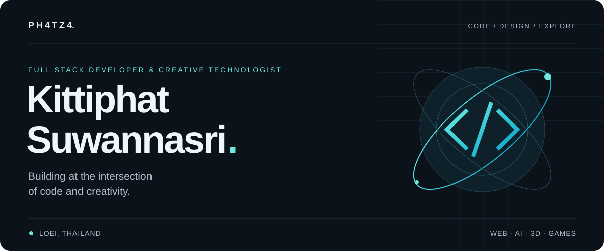
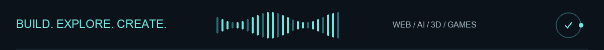
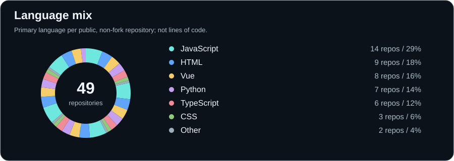
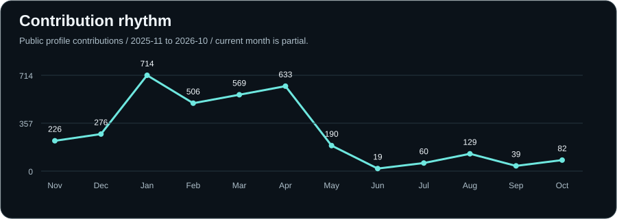
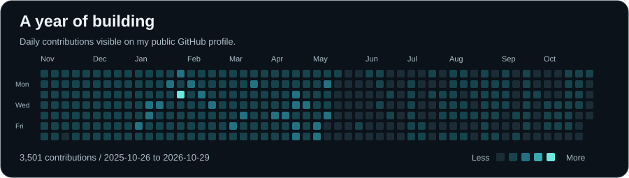
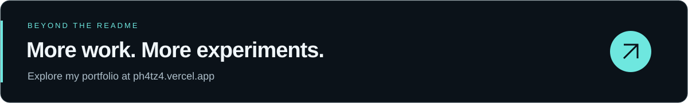

  

<picture>
  <source media="(prefers-reduced-motion: reduce)" srcset="assets/profile-motion-still.png" />
  
</picture>

  <a href="https://ph4tz4.vercel.app/"><b>Portfolio ↗</b></a> &nbsp; / &nbsp;
  <a href="#selected-work">Selected work</a> &nbsp; / &nbsp;
  <a href="KittiphatCV.pdf">Résumé</a> &nbsp; / &nbsp;
  <a href="mailto:kittiphat240449@gmail.com">Get in touch</a>

  Based in Bangkok, Thailand · Bachelor's student at Sripatum University 
  Open to collaboration across web, AI, and creative technology.

---

## A little about me

I'm **Kittiphat**, also known as **Ph4tZ4**. I build web applications, explore AI and IoT, and bring ideas to life through design, 3D animation, and games.

I'm currently pursuing a **bachelor's degree** at **Sripatum University**. My interests include backend development, AI, and creative media. My collaborations include **ICONNEXT THAILAND**.

## Selected work

<table>
  <tr>
    <td width="50%" valign="top">
      01 / AI &amp; IoT
      <h3><a href="https://github.com/Ph4tZ4/Invention_Project_2025_Smart_Parking_System_PharIQ">ParkIQ ↗</a></h3>
      
Smart parking with real-time reservations, computer vision, and ESP32 hardware.

      
Node.js · Python · MongoDB · ESP32

    </td>
    <td width="50%" valign="top">
      02 / Full Stack
      <h3><a href="https://github.com/Ph4tZ4/SugarcaneBillRecordingSystem">Sugarcane Bills ↗</a></h3>
      
A web app for recording bills, calculating prices, and exporting records to Excel.

      
React · Vite · Express · MongoDB

    </td>
  </tr>
  <tr>
    <td width="50%" valign="top">
      03 / Desktop
      <h3><a href="https://github.com/Ph4tZ4/File-reduction-program-GUI">Fast Image Resizer ↗</a></h3>
      
A desktop tool for batch image resizing, compression, and format conversion.

      
Electron · JavaScript · Canvas

    </td>
    <td width="50%" valign="top">
      04 / Interface Experiments
      <h3><a href="https://github.com/Ph4tZ4/Liquid-Glass-Card">Liquid Glass ↗</a></h3>
      
An interactive exploration of glass effects, refraction, and CSS animation.

      
HTML · CSS · JavaScript

    </td>
  </tr>
</table>

[Explore all repositories →](https://github.com/Ph4tZ4?tab=repositories)

## GitHub in graphs

  

  

  

Generated from public GitHub data · Refreshed daily · <a href="https://github.com/Ph4tZ4">View live profile ↗</a>

## My toolbox

   &nbsp;
   &nbsp;
   &nbsp;
   &nbsp;
   &nbsp;
   &nbsp;
   &nbsp;
   &nbsp;
   &nbsp;
   &nbsp;
   &nbsp;
  

| Area | Technologies |
| :--- | :--- |
| Languages | JavaScript, TypeScript, Python, PHP, C, C++, C#, Swift |
| Frontend | HTML, CSS, React, Vue, Next.js, Nuxt, Tailwind CSS, Bootstrap |
| Backend & data | Node.js, FastAPI, Flask, MongoDB, MySQL |
| Creative | Photoshop, Figma, Blender, Unity, 2D/3D animation |
| Tools & hardware | Git, Docker, VS Code, Xcode, Vite, Arduino, Raspberry Pi |

**Currently exploring:** AI & machine learning with TensorFlow · 3D printing · IoT · Game development

  
<b>Certifications & learning</b>

- [MikroTik Network Certification](MikroTik.pdf) — routing, firewall, and network configuration.
- [Stunning Photos Certificate](Stunning_Photos.pdf) — creative photography and visual composition.
- Continuing to learn networking with Cisco and MikroTik, alongside animation, content creation, and creative technology.

---

  <a href="mailto:kittiphat240449@gmail.com">Email</a> &nbsp; · &nbsp;
  <a href="https://x.com/Ph4tZ4">X</a> &nbsp; · &nbsp;
  <a href="https://www.instagram.com/k._.kttp.q/">Instagram</a> &nbsp; · &nbsp;
  <a href="https://www.facebook.com/new.kittiphat.308327">Facebook</a>

Code with purpose. Create with curiosity.

